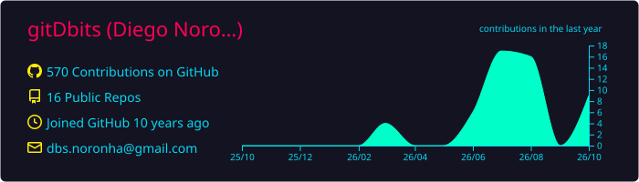

  

  

 

<h3 align="center">working set</h3>

  &nbsp;&nbsp;&nbsp;
  &nbsp;&nbsp;&nbsp;
  &nbsp;&nbsp;&nbsp;
  &nbsp;&nbsp;&nbsp;
  &nbsp;&nbsp;&nbsp;
  &nbsp;&nbsp;&nbsp;
  &nbsp;&nbsp;&nbsp;
  

 

  <a href="https://www.linkedin.com/in/diego-noronha-6a781111b/">LinkedIn</a> ·
  <a href="mailto:dbs.noronha@gmail.com">Email</a>

